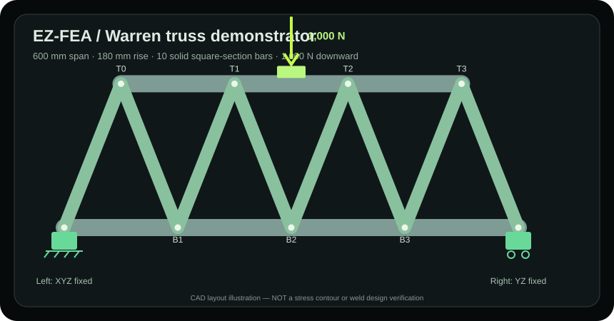

# EZ-FEA

## The product rule: **the part is the interface**

**FEA should understand the part and its likely construction—not make the user navigate an engineering-software maze.** Open a STEP model, see the actual geometry, make or remove assumptions by clicking the part, and press **SOLVE**. The sophistication belongs in the physics engine, **not in a forest of menus**.

**Our non-negotiable UI principles:**

- **Recognize common engineering intent.** Holes suggest fasteners or fixtures; planar pads suggest mounting; touching members and weldments suggest connection candidates. Use actual CAD topology and normal manufacturing/assembly practices to **propose**, never silently assert, their meaning.
- **Start with a plausible setup.** Show likely supports, contact regions, grounded components and load locations **on the model** when the evidence supports them. Each proposed restraint or joint must remain distinguishable from a verified one.
- **Easier to remove than to create.** Click a highlighted HOLD point to remove it. Click an unselected surface to add one. Select or change a connection directly on the geometry; don't force the operator through modal dialogs and deep menus for everyday tasks.
- **One obvious path:** **Open part → review highlighted connections/supports → apply load → SOLVE → see stress and deformation on the model.** Keep material, mesh, detailed joint physics and face-ID overrides available, but out of the main workflow.
- **Use clear engineering language.** Explain the weak member, excess deflection, missing restraint or uncertain joint *and why*. Flag checks the solver cannot perform. Never turn a likely bolt hole into an assumed fully fixed bolt, a touching face into a weld, or a numerical stress plot into design approval.

> **Default to sensible, reversible suggestions. Keep uncertainty visible. Make the correct engineering action the easiest action.**

**What exists today:** A black-and-lime desktop screen with a rotating real STEP preview, direct face clicking, multiple removable HOLD surfaces, a force/direction input, and native Gmsh/CalculiX results. Cylindrical CAD features adjoining planar surfaces can suggest mounting faces, which require confirmation before solving. **What's still being built:** reliable general multibody weldment/bolt/contact inference, richer automatic load cases, genuine weld and fastener physics, and visual stress contours directly on the model. The desktop is not yet an autonomous assembly analyst.

**EZ-FEA is evolving into an assembly-aware engineering analysis system** built on genuine Gmsh meshing and CalculiX physics. The goal is to take an imported CAD assembly from **geometry → detected mates → confirmed mechanical joints → meaningful loads and restraints → independently checked structural results**, without requiring engineers to manually reconstruct every connection.

EZ-FEA is part of the broader **Axiom engineering software suite**. Its future BEAN integration should explain geometric evidence, help review joints, and flag questionable assumptions; the actual structural calculations remain the responsibility of the physics engine. The [educational browser demo](https://danieloculus0-bot.github.io/EZ-FEA/) is separate from native 3D solving and must never be represented as a live arbitrary-CAD solver.

## Run the actual EZ-FEA desktop program

**This is the working black-and-lime one-screen native solver interface**; the separate GitHub Pages beam lab is **not** a solver for an arbitrary STEP upload.

1. Install **Python 3.10+**, the [Gmsh Python API](https://gmsh.info/) via `python -m pip install -r requirements.txt`, and the [CalculiX `ccx` solver](https://www.calculix.de/), available on your PATH (or set `EZFEA_CCX` to the executable path).
2. Start it from the repository directory:

   ```bash
   python app.py
   ```

3. Press **Use example** or **Open STEP**. The demo automatically selects opposite CAD end faces of a 100 × 10 × 10 mm beam. For your own part, **drag to rotate the 3D STEP preview**, tap **HOLD**, click the face you want fixed, then tap **LOAD** and click the loaded face. Both clicks retain the true CAD surface ID used by CalculiX, rather than guessing from a screenshot. Enter a force and direction. Leave the standard material/mesh defaults or open **More settings** to adjust them. For complicated STEP parts whose surface preview cannot be created, **More settings** also contains a CAD face-ID fallback; it is not part of the normal workflow.
4. Press **SOLVE**. The desktop app now shows **actual maximum displacement, integration-point von Mises stress, nominal yield-to-stress ratio, force/moment equilibrium results and mesh element count**. It saves `RESULTS.txt` with the original `source.step`, native `analysis.inp/.dat/.frd`, `case.json` and `solver.log` in one results directory. Use **Read report** or **Open results** directly in the app.

C3D10 (10-node quadratic tetrahedra) is the new default because C3D4 can be overly stiff for bending on coarse meshes. Missing Gmsh or CalculiX is detected before starting. A native solver error is never shown as a successful result; if equilibrium fails, the program explicitly marks the result **NEEDS REVIEW**, retaining the numerical evidence for investigation.

**[Dedicated true-desktop end-to-end CI](https://github.com/danieloculus0-bot/EZ-FEA/actions/workflows/desktop-app.yml)** launches the real Tk window on a virtual display, generates the true STEP surface preview, clicks a visible 3D CAD face, presses SOLVE, and verifies real Gmsh/CalculiX solver output and the UI results. This uses the existing `app.py` and `ezfea` engine—no new repo or alternate download link.

**Current supported use:** one **closed solid** STEP part, **one or more directly selected HOLD faces** and one uniformly loaded CAD face, linear isotropic static physics in N/mm/MPa. Clicking a highlighted HOLD face again removes it. When a part has cylindrical features adjoining a planar surface, the app can **suggest** an initial mounting plane; it displays that selection and requests confirmation before treating the face as an ideal fully fixed restraint. The actual hole or fastener function, bolt preload, pin/sliding joint and attachment stiffness cannot be determined from the CAD hole alone. The advanced CAD face selector remains available when necessary. Multiple distinct solids with unmodeled welds/contact remain outside this general screen. Peak stress and a nominal yield ratio **do not constitute design approval**; verify CAD units, fixtures, meshing sensitivity and independent checks.

## Planar mounting surfaces and drilled holes (current desktop beta)

EZ-FEA now extracts **actual OCCTargetUnit=MM STEP face topology**, recognizes cylindrical CAD features next to planar mounting surfaces, and suggests one candidate HOLD plane based on that evidence. The user sees it highlighted on the model, can remove it by clicking the same face, can add multiple other HOLD surfaces, and chooses the loaded face by clicking the geometry. **The automatic suggestion is not silently accepted:** the desktop asks for explicit confirmation before solving an inferred, idealized fully fixed boundary condition.

This is tested against a [real generated STEP plate with two cut through-holes](ezfea/fixture_examples.py). The [native Gmsh/topology and GUI tests](tests/test_fixture_suggestions.py) verify the face IDs match the actual STEP, not pixels or guessed coordinates; the GUI regression checks suggestion and one-click removal. Holes are **connection clues**, not proof of actual bolts or bearing stiffness. Mounting holes may be clearance, tooling, weight reduction, fluid passages or access features. **No automatic bolt, welded, pin, slip or preload physics is claimed.** Two separately held surfaces are currently represented as ideal fully restrained translational faces unless a reviewed multi-axis native case is built.

## Real example: a 10-member Warren steel truss



A **genuine CAD and CalculiX FEA example** now lives in this repository: [**Warren truss: two STEP models, actual solve and full limitations**](docs/examples/WARREN_TRUSS_EXAMPLE.md).

The demonstration generates a **10-solid multibody** weldment representation, plus a **separately fused single-solid STEP** that the existing solver can actually analyze. The first successful native run loaded the 600 mm span with 1,000 N, solved **3,595 quadratic C3D10 elements**, and measured **0.010811 mm maximum movement** and **10.107 MPa peak integration-point von Mises stress** with passing force/moment equilibrium. [Real native run and STEP download artifacts](https://github.com/danieloculus0-bot/EZ-FEA/actions/runs/40473627691).

The solid bars are **not hollow HSS/RHS tube**, and Boolean-united connections represent *ideally continuous material, not actual weld strength*. The truss uses **two support faces**, now supported by the desktop's multiple-HOLD mechanics, though the ordinary one-face LOAD screen still does not infer a full truss loading scenario or welded multibody joint physics. This is an end-to-end benchmark and a useful next GUI/assembly target—not an approved structural design.

```powershell
py -m ezfea.truss_example --solve --out runs/truss_example
```

## Product direction: from CAD assembly to structural model

1. **Import an assembly:** retain distinct solids, component identifiers, geometry and candidate connection faces. Do not indiscriminately fuse components into one solid.
2. **Choose what is grounded:** establish a reference component, traverse the connection graph and expose branches, loops, unsupported components and possible remaining degrees of freedom. Graph reachability alone is not proof of kinematic stability.
3. **Discover likely mates:** use opposing face overlap, concentric cylinders, hole patterns, clearances and fastener geometry as *evidence*. Record the paired faces and the reason each candidate exists.
4. **Review an Excel-style Joint Matrix:** present one numbered row per candidate joint, with dropdown choices such as **Welded, Bolted, Pinned, Bearing, Bonded, Sliding, Contact only**, or **Unassigned**. Allow drag-to-fill (including copying *Welded* down a full column), range editing, paste, undo/redo, filtering and CSV/Excel-oriented workflows.
5. **Define actual connection physics:** a classification does not automatically create constraints. Capture the needed weld, fastener, contact, clearance, bearing and friction parameters; map *confirmed* joints to a supported, tested CalculiX model and report any approximation.
6. **Apply realistic loads and solve:** preserve actual load paths, contact separation, restraints and material assignments. Verify reaction forces/moments, mesh sensitivity and relevant analytical/physical benchmarks before treating results as useful engineering evidence.

The system must support *connection graphs*, not assume every assembly is one simple chain. A bolted loop, welded frame, pin mechanism and detached subassembly are different mechanical problems. **Automation should reduce setup work without silently inventing structural behavior.**

### Joint Matrix — usable development preview

**[Open the Joint Matrix spreadsheet workbench](https://danieloculus0-bot.github.io/EZ-FEA/joint-matrix.html)** · [Detailed workflow and limitations](docs/JOINT_MATRIX.md)

| Available today | Planned next |
|---|---|
| Conservative opposing **axis-aligned planar STEP-face** candidate detector | Verified face overlap, concentric cylindrical mates, hole patterns and fastener grouping |
| Choose a grounded component; track graph reachability, branches and cycles | Kinematic DOF, mechanism, overconstraint and stability checks |
| Joint IDs and CAD face pairs with **Unassigned** connection physics | Evidence-backed suggested joint categories, confidence and missing-data review |
| Joint-type dropdown, drag-fill, Shift-click selection, column paste, undo/redo, CSV/JSON export | Additional Excel-like editing, filtering, parameter columns and saved assembly workflows |
| Isolated, verified two-solid STEP contact prototype | General multibody STEP/assembly contact, bonded/tied and connector models with independent validation |

The preview begins with clearly labeled **sample joints**; it can also import the actual `joint_matrix.json` or `mate_graph.json` produced by the native STEP mate scanner. It does **not** perform a structural solve when you change a dropdown. The main browser demo is intentionally not rebuilt for each engineering milestone.

## First reviewed assembly solver connection (October 26, 2026)

**[Joint Matrix → reviewed face pair → real CalculiX contact](docs/REVIEWED_ASSEMBLY_CONTACT.md)** is now implemented for a constrained two-part STEP model. The source STEP hash, two component IDs, separate CAD faces, explicit `Contact only` choice and separately selected `experimental_separable_contact` physics are checked before the native contact backend will run. It then solves compression, separation and no-contact controls. **This is not a generalized assembly solver**, and choosing only a type in the browser does not trigger calculations. [End-to-end native test workflow](https://github.com/danieloculus0-bot/EZ-FEA/actions/workflows/reviewed-assembly-contact.yml).

## Current build and verification

**Development snapshot:** October 20, 2026 · **Status:** experimental research/beta, **not** a certified engineering analysis product.

- [Tests](https://github.com/danieloculus0-bot/EZ-FEA/actions/runs/39510441434) — **Passed** at source revision `9c2a8c36ba16` (before this README update).
- [Real 3D Solver Smoke Test](https://github.com/danieloculus0-bot/EZ-FEA/actions/runs/39510441383) — **Passed** at that revision.
- [Native STEP Mate Detection and Joint Matrix](https://github.com/danieloculus0-bot/EZ-FEA/actions/runs/39510337047) — **Passed**; real two-solid STEP file yielded one candidate planar mate with 100 mm² bounding overlap and no invented joint classification.
- [Separate-solid STEP contact experiment](https://github.com/danieloculus0-bot/EZ-FEA/actions/runs/39509089816) — **Passed**; distinct C3D10 solids transmitted compression but released upon separation.

**[Live GitHub Actions](https://github.com/danieloculus0-bot/EZ-FEA/actions) is authoritative for later commits.**

## Implemented now

- Real STEP single-solid linear-static solves, multi-face fixtures/loads, numerical reaction-force **and reaction-moment** equilibrium checks.
- **Native force introduction:** choose an entire-face distributed load or a positionable Gaussian traction footprint with specified total XYZ force, center XYZ and spread (mm). Real T3/T6 surface quadrature produces equivalent FE nodal loads and reports the actual resultant force, eccentric moment and reaction balance. This approximates a pressure pad; it does **not** simulate nonlinear physical contact.
- **True native normal pressure (experimental backend):** CalculiX `*DSLOAD P` applied to real tetrahedral exterior faces, independently checked against pressure-integrated total force and support reaction moments. The [four-solve native benchmark](https://github.com/danieloculus0-bot/EZ-FEA/actions/runs/39508482477) passed for C3D4 and C3D10.
- **Real separable contact proofs:** a controlled two-brick C3D8 test transferred **962.7 N** through CalculiX frictionless contact under compression and no meaningful load during separation. A later constrained two-part STEP/C3D10 experiment also retained **zero shared nodes** and transferred compression through its detected CAD interface. These are verified prototypes, **not** a generalized assembly/contact solver. [Pressure/contact evidence](docs/PRESSURE_CONTACT.md) · [STEP experiment](https://github.com/danieloculus0-bot/EZ-FEA/actions/runs/39509089816).
- **Grounded STEP assembly mate graph + Joint Matrix prototype:** auto-detect candidate opposing planar CAD mates, preserve part/face IDs and reachability from a grounded component, and review joints in an Excel-like dropdown / drag-to-fill grid. Geometry never guesses welded/bolted/pinned physics. The new controlled **reviewed Contact only** connector maps a separately selected experimental physics model into real two-body contact. [Joint Matrix instructions](docs/JOINT_MATRIX.md) · [contact bridge](docs/REVIEWED_ASSEMBLY_CONTACT.md).
- Six native frame specimens and repeatable multi-grid mesh refinement; C3D4/C3D10 element-order studies have independent CI.
- [Browser demo](https://danieloculus0-bot.github.io/EZ-FEA/) performs simplified beam physics and displays archived native results. Arbitrary uploaded CAD is **preview only**.

## Run and test

For native analyses, install the Gmsh Python package and CalculiX (`ccx`), and consult the [earlier installation and validation guide](docs/archive/README_2026-10-20_before_refresh.md).

```bash
# Existing single-solid native mesh-refinement experiment
python -m ezfea.convergence --demo --meshes 12 8 5

# Scan candidate planar mates in a multi-solid STEP assembly
python -m ezfea.assembly_mates path/to/assembly.step --out mates.json

# Produce verified sample STEP, geometric mate graph and spreadsheet files
python -m scripts.build_assembly_mate_evidence --out runs/mate_review
```

Open the [Joint Matrix](https://danieloculus0-bot.github.io/EZ-FEA/joint-matrix.html), choose **Import scanned joints JSON**, and select the generated `mates.json` or `joint_matrix.json`. The workbench initially displays sample rows until you import actual evidence. For automated verification, see [Tests](https://github.com/danieloculus0-bot/EZ-FEA/actions/workflows/test.yml), [Mate Detection](https://github.com/danieloculus0-bot/EZ-FEA/actions/workflows/assembly-mate-review.yml), and [Native Contact](https://github.com/danieloculus0-bot/EZ-FEA/actions/workflows/step-contact.yml).

## BEAN learns from independently held-out native FEA (October 26, 2026)

**[Actual C3D10 training corpus generator](ezfea/native_learning_cases.py)** builds **42 varied STEP specimens** spanning axial tension/compression, cantilever bending and pure round-shaft torsion. Twelve specimens are designated training; thirty have physically different CAD dimensions and are reserved for testing. The generator archives every solver input/result and never substitutes idealized equations for native labels. Failed solves remain visible and block the training gate.

The [**EZ-FEA smoke workflow**](https://github.com/danieloculus0-bot/EZ-FEA/actions/workflows/native-learning-cases.yml) verifies the real meshing/result path. The separate [**BEAN real-FEA learning workflow**](https://github.com/danieloculus0-bot/BEAN/actions/workflows/bean-real-fea-learning.yml) trains the existing BEAN SpongeTD learner on measured solver residuals and scores the frozen policy against unseen geometry. Check completed runs for actual scores: generating 42 definitions alone does **not** mean BEAN generalized or beat classical mechanics. No real fracture, physical test coupon, arbitrary assembly or design approval is included.

## Native circular-shaft torsion — real solver verification (October 26, 2026)

**[Actual STEP/CalculiX torsion evidence](docs/NATIVE_TORSION.md)** now demonstrates consistent tangential FE loading, nearly zero net force, fixed-end reaction-torque verification and tip twist measured from real C3D10 displacements. A 4 mm mesh of 2,541 tetrahedra differed from the independent circular-shaft twist reference by **0.00291%**, with approximately **0.00000277%** torque reaction error. **General geometry, weld, bolt and assembly torque support remains experimental/unverified.**

## Latest physics verification

**[October 26 native evidence: inch/mm STEP, mesh refinement, bending and shear](docs/VALIDATION_SNAPSHOT_2026-10-26.md)** includes measured discrepancies, archived solver runs, and the remaining numerical limitations. Stress-probe screening and independently tested closed-form torsion calculations have been added; arbitrary native torsion analysis is not yet validated.

### Earlier October 20 baseline

- [**12 real load-footprint simulations**](https://github.com/danieloculus0-bot/EZ-FEA/actions/runs/39507346099) using C3D4/C3D10 on 10 and 7 mm meshes: uniform whole-face traction versus centered and eccentric finite Gaussian pads, all at the same 100 N axial force. At 7 mm C3D10, moving the pad raised the applied bending moment from **500 to 679 N·mm** and peak recorded native stress from **1.03 to 2.44 MPa**. Every case passed numerical force and moment equilibrium. [Native workflow](https://github.com/danieloculus0-bot/EZ-FEA/actions/workflows/load-introduction.yml).
- [36 real frame solves comparing C3D10 Gauss-coordinate stress reconstruction](https://github.com/danieloculus0-bot/EZ-FEA/actions/runs/39505031019): same XYZ stress sampling; **8/24** physical probe histories met the provisional 10% two-step criterion, compared with **1/24** using element-mean stress recovery. Six other probes remain boundary-adjacent; ten are still mesh-sensitive.
- [12 native analytical axial and bending comparison solves](https://github.com/danieloculus0-bot/EZ-FEA/actions/runs/39505678274): at 7 mm mesh, **C3D10** cantilever deflection was 0.200384 mm against an Euler–Bernoulli reference of 0.200000 mm (0.192% difference). At the same fixed material stress point, C3D10 produced 18.979 MPa against a 19.3644 MPa analytical bending stress (1.99% difference). C3D4 was much too stiff at this mesh density.
- [Automated native analytical benchmark workflow](https://github.com/danieloculus0-bot/EZ-FEA/actions/workflows/analytic-stress-benchmark.yml) now tests tensile and bending behavior independently of the solver code; full details, limits and methods remain in [engineering validation notes](docs/VALIDATION.md).

These measurements support a limited experimental solver regression baseline, **not** general-purpose engineering certification. The [browser demo](https://danieloculus0-bot.github.io/EZ-FEA/) is deliberately unchanged.

## Unverified and out of scope

- Not validated for engineering sign-off. Mesh stability is not physical accuracy, and idealized fixed-edge stresses may diverge.
- The generic `Analysis` API is still single-solid. The two controlled contact prototypes do **not** establish arbitrary STEP assembly solving, welds, fasteners, pins, bearings, joint friction or actuator mechanics.
- Current geometric detection is limited to planar bounding-box candidates; a detected mate is **not** a confirmed mechanical connection. Changing only a Joint Matrix type never creates solver constraints; a separately confirmed and checked contact-only model can execute the narrow experimental bridge.
- Independent verification of general load cases, realistic joint behavior, curved geometry and contact-pressure convergence remains incomplete.
- Native solver CI success and the browser's educational beam result are different verification scopes.

## Development roadmap

**[Production-readiness targets and evidence requirements](docs/PRODUCTION_READINESS.md)** define the first realistic supported release, its current gaps, and the next native verification work. This does not hold experimental features off `main`.


1. **Expand candidate mate detection:** compute actual planar face overlap (not only bounding boxes), recognize concentric cylindrical surfaces and pin/bearing axes, detect matched fastener-hole groups, evaluate clearances and provide geometry-grounded confidence and evidence. Preserve stable identities across assembly reimports.
2. **Finish the engineering Joint Matrix:** robust large-assembly range fill, paste, filtering, row grouping and Excel-compatible round-trip; columns for joint dimensions and engineering assumptions (weld size, bolt pattern/preload, bearing clearance, friction). BEAN may suggest and explain classifications, but confirmation and provenance remain explicit.
3. **Connect confirmed joints to native physics:** first validate bonded/tied interfaces and frictionless separable contacts on independent STEP solids, then pins/bearings and simplified bolt groups. Verify DOFs, load transfer, reaction force/moment balance, separation and convergence separately for each connector family. Do not silently convert every selected *Welded* label into a rigid tie.
4. **Assembly-wide solve and review:** material mapping, realistic face pressure/traction, multi-part meshing, mechanism/overconstraint detection, accessible stress/displacement results and reproducible solver artifacts. Add independent shear, torsion, joint and stress-concentration benchmarks.
5. **Axiom/BEAN integration milestone:** reuse shared module contracts and the coherent dark/lime engineering UI. BEAN should explain mate evidence, missing inputs and validation flags; CalculiX/Gmsh still perform actual mechanics. Update the public demo at substantial, verified milestones, not with every internal experiment.

**Success criterion:** Import a practical fabricated assembly, ground it, identify candidate joints, classify them efficiently in a spreadsheet, confirm real connection parameters, and obtain a mechanically defensible analysis with traceable assumptions and verification.

## Reference

- [Browser demo](https://danieloculus0-bot.github.io/EZ-FEA/)
- [Validation report](docs/VALIDATION.md)
- [Native pressure & separable contact evidence](docs/PRESSURE_CONTACT.md)
- [Grounded assembly Joint Matrix and real STEP mate-detection test](docs/JOINT_MATRIX.md)
- [Standalone Joint Matrix workbench](https://danieloculus0-bot.github.io/EZ-FEA/joint-matrix.html)
- [Native STEP mate-scanner source](ezfea/assembly_mates.py) · [Joint Matrix model](ezfea/joint_matrix.py)
- [Mesh refinement code](ezfea/convergence.py)
- [**Archived full README: development history, experiments and original setup details**](docs/archive/README_2026-10-20_before_refresh.md)
